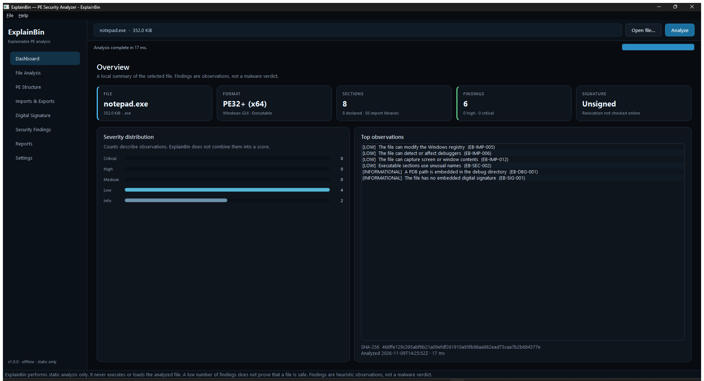
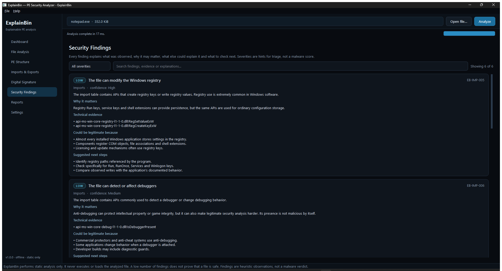
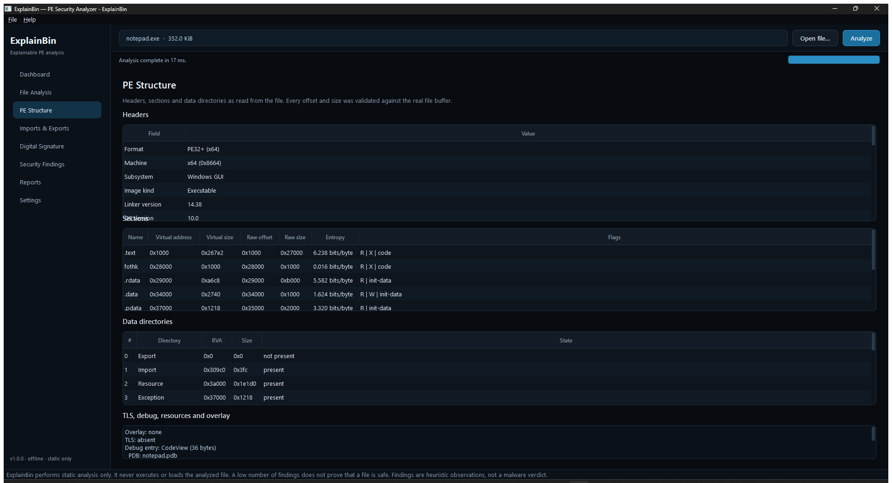
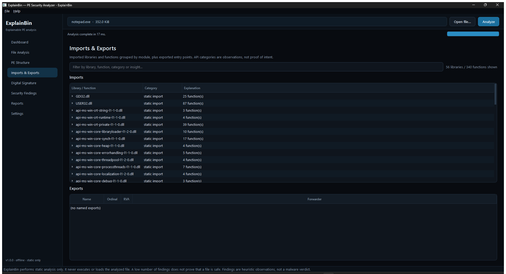
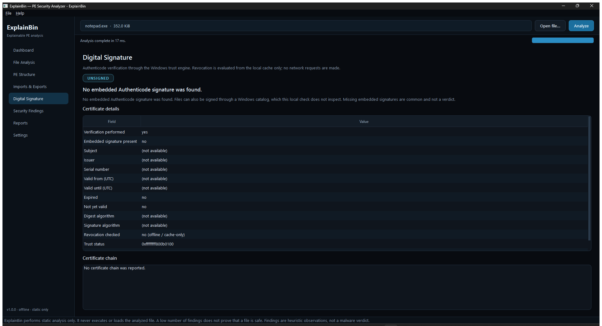

# ExplainBin

**A local, explainable Windows PE security analyzer.**

ExplainBin inspects Windows executables, DLLs and drivers **without running them**. It explains what it observed, why the observation can matter, which legitimate scenarios can produce the same pattern, and what to investigate next. It never produces a misleading "malware percentage".

[](.github/workflows/ci.yml)
[](LICENSE)
[](#requirements)
[](#requirements)
[](#requirements)

> **Static analysis is not a verdict.** ExplainBin never executes, loads, maps or uploads the analyzed file. Findings are heuristic observations. A low finding count does not prove that a file is safe; a high count does not prove that it is malicious.

---

## Why ExplainBin exists

Most "suspicious file" tools reduce an executable to a number or a red/green icon. That hides reasoning and creates false confidence. ExplainBin takes the opposite approach: every finding contains

| Field | Purpose |
| --- | --- |
| **ID** | Stable rule identifier, for example `EB-SEC-001` |
| **Category** | Sections, imports, signature, TLS, overlay, ... |
| **Severity** | Informational, Low, Medium, High, Critical |
| **Confidence** | How strongly the evidence supports the observation |
| **What was observed** | Factual description with technical evidence |
| **Why it matters** | Plain-language impact of the capability or structure |
| **Legitimate explanations** | Common benign reasons for the same pattern |
| **Recommended investigation** | Concrete next steps that do not require execution |

## Features

- **Bounds-checked PE parser**: DOS/NT headers, optional headers, sections, data directories, imports, delay imports, exports, resources, debug/CodeView, TLS callbacks, certificate table, overlay and Rich header. Every offset and size is validated against the real file buffer.
- **Malformed-file safety**: truncation, absurd counts, unmapped RVAs, cyclic resource trees and out-of-range section data produce diagnostics instead of crashes.
- **Cryptographic hashes**: SHA-256, SHA-1 and optional MD5 via Windows CNG (`bcrypt`), computed over the same byte buffer that was parsed.
- **Authenticode verification**: embedded signatures and locally installed Windows catalog signatures, validated with WinVerifyTrust, with signer/certificate details via Crypt32. Revocation is cache-only/local by design.
- **Import intelligence**: API categorization plus transparent capability-combination rules (for example process-memory writes + remote thread creation), always with legitimate explanations.
- **Entropy and packing indicators**: whole-file and per-section Shannon entropy, unusual section names, writable+executable sections, overlapping sections, zero-raw executable sections.
- **Explainable findings**: stable rule IDs, severity, confidence, evidence, benign explanations and next steps. No opaque malware score.
- **Reports**: schema-stable JSON, self-contained dark HTML and plain text. Reports are written locally. See [docs/REPORT_SCHEMA.md](docs/REPORT_SCHEMA.md) for the JSON contract.
- **GUI and CLI**: Qt 6 Widgets desktop application and a headless `explainbin-cli` for automation.
- **Tests and CI**: GoogleTest suite with synthetic PE fixtures, no malware samples or binary fixtures required.

## Screenshots

| Dashboard | Security findings |
| --- | --- |
|  |  |

| PE structure | Imports and exports |
| --- | --- |
|  |  |

| Digital signature |
| --- |
|  |

> Screenshots are captured from the running Qt application while it analyzes a standard Windows binary. No malware samples are used.

## Requirements

- Windows 10 or Windows 11 (x64)
- CMake 3.24 or newer
- A C++20 compiler:
  - Visual Studio 2022 with the **Desktop development with C++** workload, or
  - MinGW-w64 with GCC 13+ (UCRT or MSVCRT)
- Qt 6.5+ with the **Widgets**, **Svg** and **Concurrent** modules (GUI only)
- Ninja or Visual Studio generator
- Network access for the first configure if `nlohmann/json` or GoogleTest is not installed (CMake FetchContent)

The core and CLI use only the Windows SDK and Windows CNG/WinTrust APIs. They do not require OpenSSL at build time.

## Build

### Visual Studio 2022 (Developer PowerShell)

```powershell
cmake -S . -B build -G Ninja `
  -DCMAKE_BUILD_TYPE=Release `
  -DCMAKE_PREFIX_PATH="C:\Qt\6.8.0\msvc2022_64"
cmake --build build
```

### MinGW-w64

```powershell
cmake -S . -B build -G Ninja `
  -DCMAKE_BUILD_TYPE=Release `
  -DCMAKE_CXX_COMPILER=g++ `
  -DCMAKE_PREFIX_PATH="C:\Qt\6.8.0\mingw_64"
cmake --build build
```

### Core and CLI only (no Qt required)

```powershell
cmake -S . -B build -G Ninja `
  -DCMAKE_BUILD_TYPE=Release `
  -DEXPLAINBIN_BUILD_UI=OFF `
  -DEXPLAINBIN_BUILD_TESTS=OFF
cmake --build build
```

### Tests

```powershell
cmake -S . -B build -G Ninja -DEXPLAINBIN_BUILD_UI=OFF
cmake --build build
ctest --test-dir build --output-on-failure
```

### Install

```powershell
cmake --install build --prefix dist
```

### CMake options

| Option | Default | Description |
| --- | --- | --- |
| `EXPLAINBIN_BUILD_UI` | `ON` | Build the Qt 6 desktop application |
| `EXPLAINBIN_BUILD_CLI` | `ON` | Build the `explainbin-cli` analyzer |
| `EXPLAINBIN_BUILD_TESTS` | `ON` | Build the GoogleTest suite |
| `EXPLAINBIN_WARNINGS_AS_ERRORS` | `OFF` | Treat compiler warnings as errors |

## Usage

### GUI

Run `build\ExplainBin.exe` (or `build\Release\ExplainBin.exe` with multi-config generators). Open a `.exe`, `.dll`, `.sys`, `.scr` or `.cpl` file and navigate:

- **Dashboard**: file identity, hashes, signature state, severity counts, quick observations
- **File Analysis**: end-to-end summary and analysis diagnostics
- **PE Structure**: headers, sections, data directories, overlay and TLS
- **Imports & Exports**: libraries, categorized APIs and insights
- **Digital Signature**: embedded or catalog signature state, signer, issuer, validity, trust detail and revocation policy
- **Security Findings**: filterable, expandable findings with evidence and investigation steps
- **Reports**: export JSON, HTML or text
- **Settings**: signature verification, MD5, size limit and theme

Analysis runs on a background thread so the UI remains responsive. Closing the window waits for the current analysis to finish.

### CLI

```powershell
explainbin-cli C:\Windows\System32\notepad.exe
explainbin-cli sample.exe --json report.json --html report.html --text report.txt
explainbin-cli sample.exe --no-signature --max-size 512
```

Exit codes: `0` success, `2` invalid arguments, `3` analysis failed, `4` report write failed.

## What ExplainBin does and does not do

**Does**

- Read the file once with a read-only handle and analyze those exact bytes
- Validate every PE offset, size and count before access
- Verify Authenticode signatures through the Windows trust provider
- Explain capability combinations with benign alternatives
- Write reports only to paths you choose

**Does not**

- Execute, load, map, debug, emulate or unpack the analyzed file
- Upload the file or its hashes
- Download content or contact the sample
- Check certificate revocation online (cache-only policy)
- Provide a malware/clean verdict or a "malware percentage"
- Replace a sandbox, an endpoint product or human judgment

## Rule model

Rules use stable IDs grouped by area:

| Prefix | Area | Examples |
| --- | --- | --- |
| `EB-PE-` | PE structure | unparseable image, partial parse, checksum, overlay, alignment |
| `EB-SEC-` | Sections and layout | writable+executable, unusual names, entropy, overlaps |
| `EB-IMP-` | Imports | injection sequence, input capture, download-and-execute |
| `EB-SIG-` | Authenticode | unsigned, valid, invalid, indeterminate |
| `EB-TLS-` | TLS | callbacks before entry point |
| `EB-DBG-` | Debug metadata | embedded PDB path |

See [docs/RULES.md](docs/RULES.md) for the full list and the reasoning behind each rule.

### Accuracy principles

- Rules distinguish **observed behavior** from **capability**. Import combinations that only show what a file *could* do are rated Low or Medium and list benign explanations.
- Generic native NT APIs (for example `NtAllocateVirtualMemory`) do not trigger injection findings on their own; explicit cross-process APIs are required.
- Modules that both import and export an API (such as `kernel32.dll` and `kernelbase.dll`) are treated as API providers, not injection tools.
- Known Microsoft system section names (`.text`, `PAGE`, `RT`, `fothk`, `SCPCFG*`, ...) and case variants such as `.TEXT` are not treated as unusual.
- Locally installed Windows catalogs are checked before a file is reported as unsigned.
- High entropy in read-only resource or relocation sections is not reported as packing.

## Architecture

```
include/explainbin/
  core/       data model, parser, analyzer pipeline, findings, signature
  reports/    JSON / HTML / text exporters and file writer
  ui/         Qt 6 widgets, views, theme, custom controls
src/
  core/       implementation of the static analysis engine
  reports/    exporter implementation
  ui/         desktop application implementation
  cli/        headless analyzer
tests/        GoogleTest suite and synthetic PE builder
docs/         architecture, rules, build notes, roadmap
resources/    Qt resources and SVG icons
```

The analysis pipeline is strictly one-directional:

```
FileReader -> HashCalculator
           -> PEParser -> EntropyAnalyzer -> ImportAnalyzer
           -> SignatureVerifier
           -> FindingsEngine
           -> AnalysisResult -> JSON / HTML / Text
```

The core library has no Qt dependency, so it can be embedded in services, CI jobs or other front ends. See [docs/ARCHITECTURE.md](docs/ARCHITECTURE.md).

## Safety notes for analysts

- Analyze untrusted files on a machine you can afford to rebuild.
- ExplainBin is designed not to execute samples, but treat any analysis tool as part of your attack surface.
- Signature validity proves provenance and integrity of the signed bytes, not safety.
- Absence of findings can mean "nothing matched", "packed", "statically linked" or "analysis incomplete".
- For behavioral questions, use an isolated sandbox. Static analysis cannot observe runtime behavior.

## Contributing

Contributions are welcome. Read [CONTRIBUTING.md](CONTRIBUTING.md) before opening a pull request. Security issues should follow [SECURITY.md](SECURITY.md). Release notes are recorded in [CHANGELOG.md](CHANGELOG.md).

## License

MIT. See [LICENSE](LICENSE).
